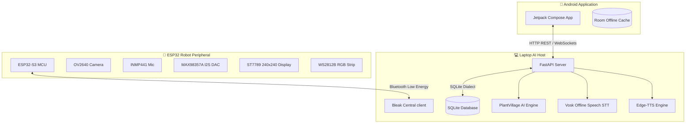

# AgroMate System Architecture

This document outlines the architectural redesign of the AgroMate AI Farming Robot.

## Architectural Goal

The previous architecture relied on a Raspberry Pi mounted directly on the robot. This setup had severe limitations regarding power efficiency, thermal dissipation, and AI processing power.

The redesigned architecture:
1. **Removes the Raspberry Pi** from the physical robot.
2. Replaces it with a high-performance **Laptop or Desktop computer** acting as the central AI Server.
3. Uses a lightweight, low-power **ESP32 microcontroller** (specifically ESP32-S3) as the robot controller.
4. Uses **Bluetooth Low Energy (BLE)** to bridge communication between the robot and the laptop.
5. Uses a **companion Android App** connected via Wi-Fi/WebSockets to monitor health, review logs, and chat.

---

## Component Topology

---

## Data Pipelines

### 1. Plant Disease Diagnosis (Camera)
- Physical button pressed on the robot triggers a capture event.
- ESP32 captures a VGA JPEG frame using `esp_camera`.
- ESP32 transmits the image to the laptop via chunked BLE transfer (`img_tx` characteristic).
- Laptop AI Engine parses the image:
  - Runs PlantVillage convolutional classifier.
  - Generates disease diagnosis reports.
  - Saves the record in SQLite database.
- Laptop sends an `AI_RESPONSE` command back to the robot containing expression changes (e.g. `HAPPY` or `ERROR`) and text diagnosis.
- Laptop notifies the Android companion app of the new scan record via WebSocket connection.

### 2. Live Voice Queries (Chatbot)
- Push-to-talk button held on the robot triggers audio recording.
- I2S Microphone captures voice audio at 16kHz 16-bit mono.
- ESP32 transmits raw PCM audio chunks over `audio_tx` characteristic to the laptop.
- Laptop processes audio:
  - Transcribes text using Vosk offline models (English/Hindi/Gujarati).
  - Queries local AI Knowledge base for remedies.
  - Generates speech audio response using Edge-TTS.
- Laptop streams completed TTS audio chunks to the robot on `cmd_tx` characteristic.
- ESP32 writes audio stream to I2S DAC for real-time playback.
- ESP32 syncs mouth rendering animation based on audio playback volume levels.
