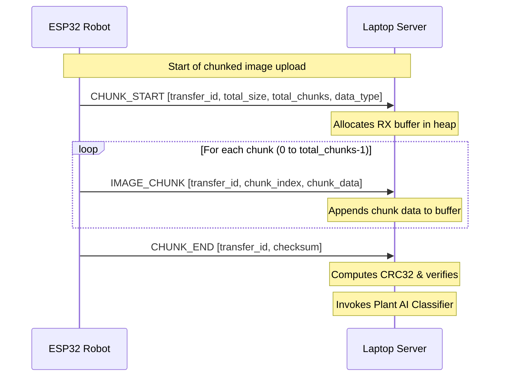

# AgroMate Bluetooth Low Energy (BLE) Communication Protocol

This document defines the custom binary framing protocol used for low-latency communication between the laptop AI server and ESP32 robots.

## Frame Format

Every BLE message sent over the command/data characteristics must be framed according to the following layout:

```
┌──────────┬──────────┬──────────┬──────────┬──────────┬──────────┐
│ SYNC (2) │ TYPE (2) │ SEQ (2)  │ LEN (4)  │ PAYLOAD  │ CRC (2)  │
│ 0xA6 0xAD│          │          │          │ (0-512)  │          │
└──────────┴──────────┴──────────┴──────────┴──────────┴──────────┘
```

- **SYNC (2 bytes)**: Fixed synchronization bytes `0xA6` and `0xAD`.
- **TYPE (2 bytes)**: Message type identifier (little-endian uint16_t).
- **SEQ (2 bytes)**: Sequence number for packet tracking (little-endian uint16_t).
- **LEN (4 bytes)**: Length of the payload in bytes (little-endian uint32_t).
- **PAYLOAD (0 - 512 bytes)**: Variable-length payload data.
- **CRC (2 bytes)**: CRC16 generated from the lower 16 bits of standard IEEE 802.3 CRC32 computed over header + payload (little-endian uint16_t).

---

## Message Types

| Code (Hex) | Direction | Type | Description |
|------------|-----------|------|-------------|
| `0x0001` | ESP → Laptop | `IMAGE_CHUNK` | Multi-packet camera image chunk |
| `0x0002` | ESP → Laptop | `AUDIO_CHUNK` | Multi-packet microphone audio chunk |
| `0x0003` | ESP → Laptop | `SENSOR_DATA` | Packaged battery level + environmental metrics |
| `0x0004` | ESP → Laptop | `HEARTBEAT` | Connection keepalive |
| `0x0005` | ESP → Laptop | `BUTTON_EVENT` | Physical button press event |
| `0x0006` | ESP → Laptop | `TOUCH_EVENT` | Capacitive touch sensor trigger |
| `0x0007` | ESP → Laptop | `CAMERA_CAPTURE_DONE` | Notification that capture completed |
| `0x0010` | Laptop → ESP | `AI_RESPONSE` | Text response and expression command |
| `0x0011` | Laptop → ESP | `SPEECH_AUDIO` | TTS audio chunks for local playback |
| `0x0012` | Laptop → ESP | `FACE_COMMAND` | Manual face expression override |
| `0x0013` | Laptop → ESP | `LED_COMMAND` | RGB strip animations command |
| `0x0014` | Laptop → ESP | `SERVO_COMMAND` | Servo tilt/pan positions command |
| `0x0015` | Laptop → ESP | `STATUS_UPDATE` | System status text |
| `0x0016` | Laptop → ESP | `CAPTURE_REQUEST` | Trigger camera snapshot |
| `0x0017` | Laptop → ESP | `RECORD_REQUEST` | Trigger voice recording |
| `0x0020` | Bidirectional | `ACK` | Acknowledgment of sequence |
| `0x00FE` | Bidirectional | `CHUNK_START` | Multi-chunk transfer initialization |
| `0x00FF` | Bidirectional | `CHUNK_END` | Multi-chunk transfer completion & verify |

---

## GATT Service Layout

The ESP32 advertises a primary service with UUID `12345678-1234-5678-1234-56789abcde01` containing these characteristics:

- **Command Tx (`cmd_tx`)** `...abcdf01`: Write/Write w/o Response. Central writes commands here.
- **Command Rx (`cmd_rx`)** `...abcdf02`: Notify. ESP32 notifies responses here.
- **Image Tx (`img_tx`)** `...abcdf03`: Notify. ESP32 sends image chunk transfers.
- **Audio Tx (`audio_tx`)** `...abcdf04`: Notify. ESP32 sends mic chunk transfers.
- **Audio Rx (`audio_rx`)** `...abcdf05`: Write/Write w/o Response. Central writes speech audio chunks.
- **Battery (`battery`)** `...abcdf06`: Read/Notify. ESP32 notifies battery percentage.
- **Sensors (`sensors`)** `...abcdf07`: Read/Notify. ESP32 notifies sensor reports.
- **Heartbeat (`heartbeat`)** `...abcdf08`: Notify. ESP32 notifies heartbeats.

---

## Chunked Data Reassembly Flow

Large transfers (e.g. JPEG images or audio recordings) exceeding MTU boundaries are transferred via chunked streams:


